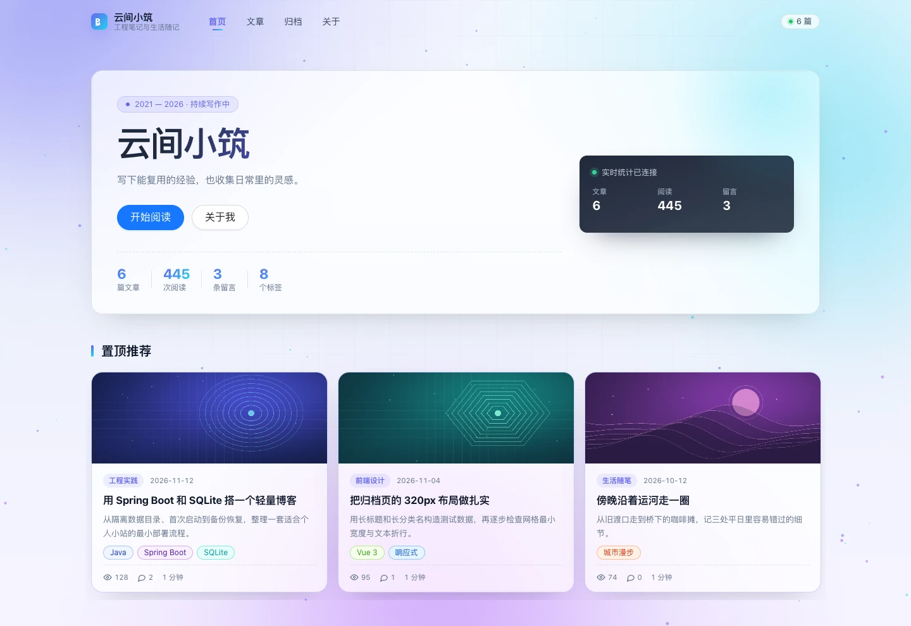
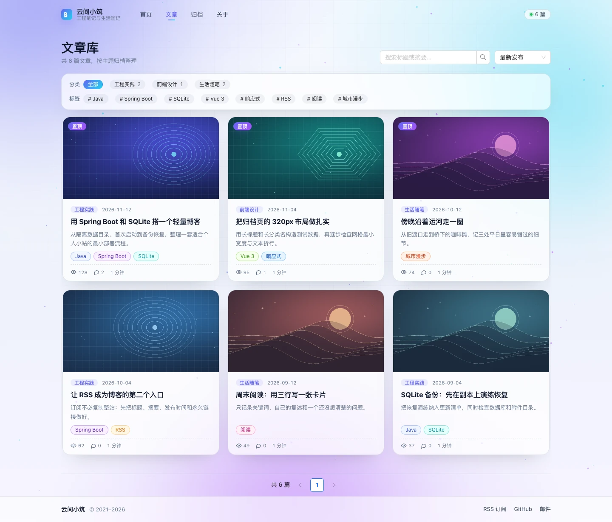
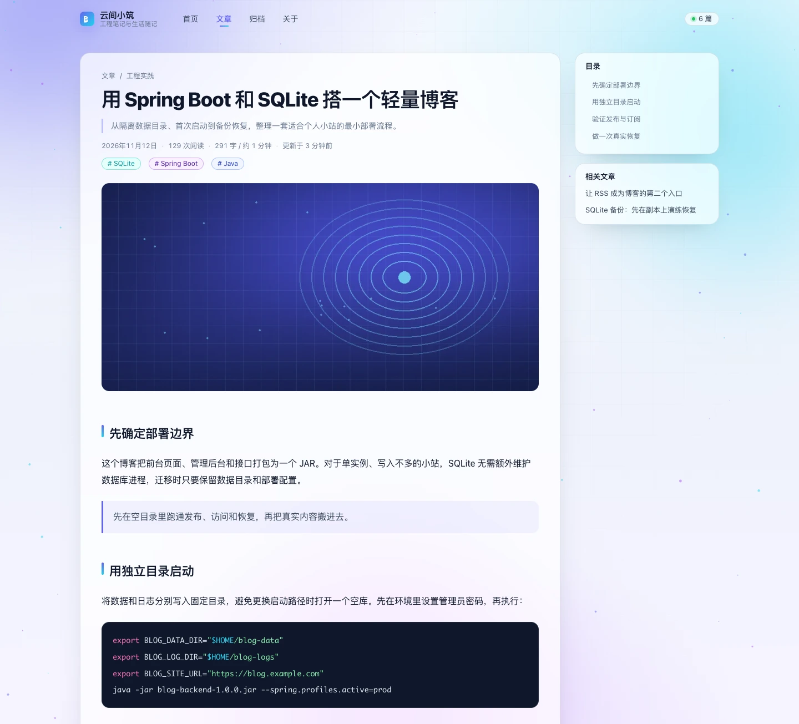
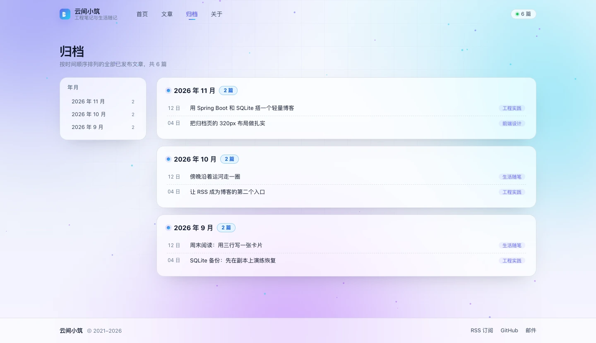
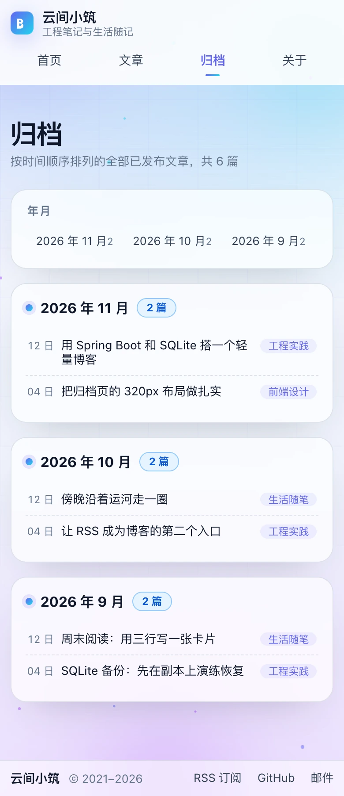
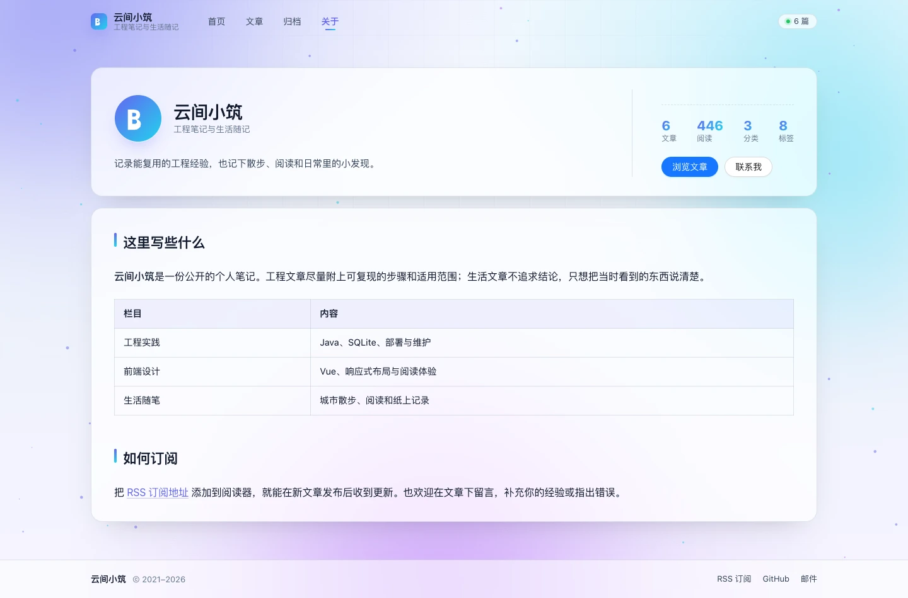
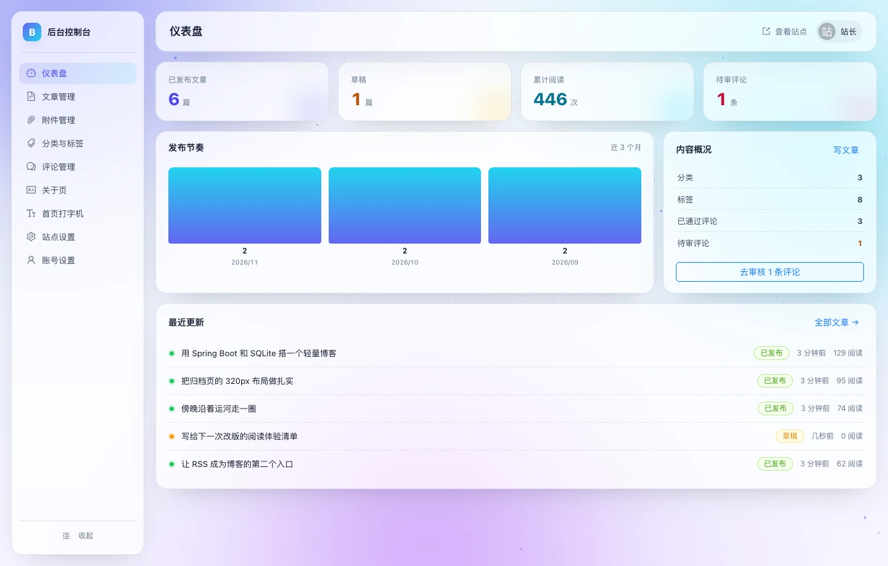
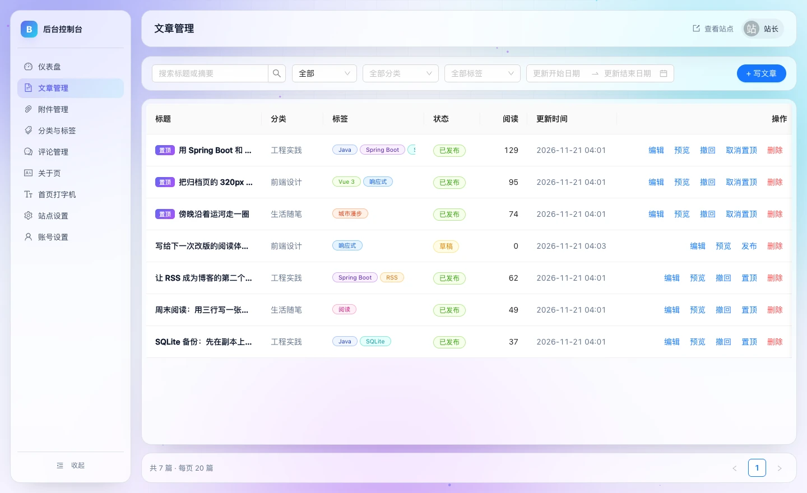
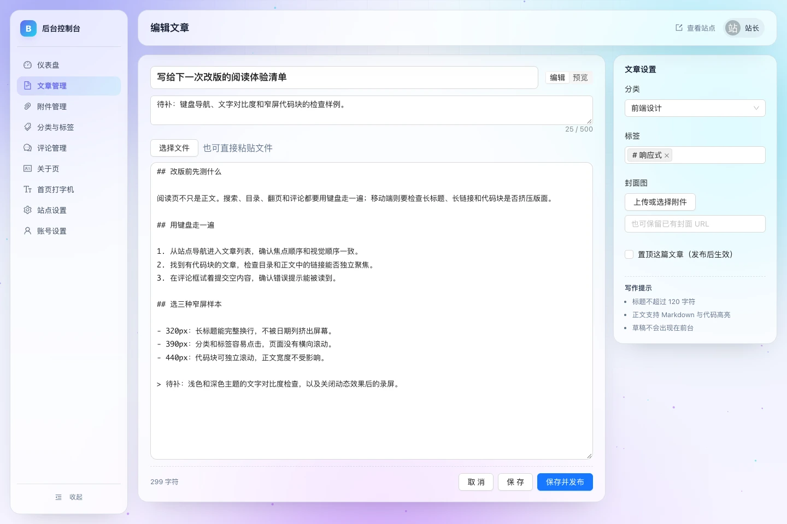

# 云间小筑 · 个人博客系统

一个使用 Spring Boot、SQLite 和 Vue 3 的个人博客。开发时前后端可以分别运行；部署时可打包为一个 JAR，同时提供网页、REST 接口和 RSS 订阅，无需单独部署数据库服务。

## 功能

- **前台**：文章列表、分类与标签筛选、归档、关于页、评论、RSS 订阅，以及首页置顶轮播、实时统计和背景音乐。页面支持移动端布局和系统「减少动态效果」设置。
- **内容管理**：Markdown 编辑与预览、文章发布／撤回／置顶、分类标签维护、评论审核和附件管理。文章、评论、附件的筛选在服务端分页前执行；后台预览不增加阅读量。
- **站点设置**：站点资料、头像、备案信息、背景音乐和账号资料。独立的「首页打字机」菜单支持最多 30 条文案，可按站点时区配置生效星期、时段和播放顺序；起止相同表示全天，跨午夜以勾选的星期为开始日。

## 页面截图

以下截图来自本地运行的演示站点。示例文章分为「工程实践」「前端设计」「生活随笔」，包含已发布文章、置顶推荐和后台草稿；首次启动不会自动导入这些内容。

### 博客首页



<details>
<summary>文章列表与详情</summary>

#### 文章列表 · `/articles`



#### 文章详情 · `/articles/:id`



</details>

<details>
<summary>归档（桌面与移动端）和关于页</summary>

#### 归档 · `/archives`



<p></p>

#### 关于 · `/about`



</details>

<details>
<summary>管理后台：仪表盘、文章列表与编辑器</summary>

#### 仪表盘 · `/admin/dashboard`



#### 文章管理 · `/admin/articles`



#### 文章编辑 · `/admin/articles/:id/edit`



</details>

## 技术栈与环境

| 用途 | 选型 |
| --- | --- |
| 后端构建 | **JDK 21**、Maven 3.9（以 [`backend/pom.xml`](backend/pom.xml) 为准） |
| 后端 | Spring Boot 3.5.16、Spring MVC、虚拟线程、Reactor |
| 持久化与认证 | SQLite（WAL）、MyBatis-Plus 3.5.18、Sa-Token 1.46.0 |
| 前端构建 | 建议 **Node.js 22.12+** 与 npm，使用 `package-lock.json` 锁定依赖 |
| 前端 | Vue 3.5、Vite 6、Ant Design Vue 4、Vue Router、Pinia |
| 接口文档 | springdoc-openapi 2.8.13、Knife4j UI 4.5.0（仅静态资源） |

如本机有多个 JDK，打包 JAR 前先运行 `mvn -v`，确认 Maven 使用的是 JDK 21。

## 本地开发

以下命令从仓库根目录执行，后端和前端各用一个终端。

**终端一：启动后端**

```sh
mvn -f backend/pom.xml package
java -jar backend/target/blog-backend-1.0.0.jar --spring.profiles.active=dev
```

- API 冒烟检查：<http://localhost:8080/api/public/site>
- 开发接口文档：<http://localhost:8080/doc.html>
- 首次启动自动建表，默认不导入演示数据。由仓库根目录启动时，SQLite 文件为 `./data/blog.db`；若从其他目录启动，`./data` 随工作目录变化。可用 `BLOG_DATA_DIR` 指定固定目录。

**终端二：启动前端**

```sh
cd frontend
npm ci
npm run dev
```

- 博客首页：<http://localhost:5173/>
- 管理后台：<http://localhost:5173/admin/login>
- Vite 将 `/api` 和 `/rss.xml` 代理到 `localhost:8080`。
- 本地首次初始化默认账号为 `admin` / `admin123`。仅用于本地开发；生产环境请在首次启动前配置强密码。初始化不会为已存在的同名账号重置密码。

## Docker Compose 部署

安装 Docker 和 Compose 插件（`docker compose version`）后，在仓库根目录执行：

```sh
cp .env.example .env
# 编辑 .env，设置必填的 BLOG_ADMIN_PASSWORD（仅用于初始化管理员）。
```

两个 Compose 文件可独立运行。需要同时运行时，分别执行下面两条命令：

| 版本 | 启动命令 | 默认访问地址 |
| --- | --- | --- |
| GraalVM Native Image（Alpine） | `docker compose -f docker-compose.native.yml up -d --build --wait` | <http://127.0.0.1:8081/> |
| Spring Boot JAR（Java 21） | `docker compose -f docker-compose.jar.yml up -d --build --wait` | <http://127.0.0.1:8082/> |

两版都内置前端，后台入口为 `/admin/login`。默认只绑定回环地址，分别使用独立的 SQLite、附件和日志卷；两版的文章和账号修改不会同步。可在 `.env` 中调整端口和监听地址；使用反向代理时，将对应的 `BLOG_NATIVE_SITE_URL` 或 `BLOG_JAR_SITE_URL` 设为访客使用的公网地址，保证 RSS 链接正确。

以下以 JAR 版为例，操作 Native 版时将文件名换成 `docker-compose.native.yml`：

```sh
docker compose -f docker-compose.jar.yml ps
docker compose -f docker-compose.jar.yml logs -f
docker compose -f docker-compose.jar.yml down  # 只停止 JAR 版并保留数据卷。
```

不要使用 `down -v`，除非需要清空对应版本的数据。若用旧的合并配置启动过，旧数据卷不会被新项目自动使用，请先备份旧数据再迁移。

Native Image 首次从源码构建较慢。也可下载 [同架构的 Alpine 镜像归档](#graalvm-native-imagemacosalpine-dockerwindows)，直接导入后运行，不必重新编译：

```sh
docker load -i blog-alpine-arm64.tar.gz  # x86-64 主机改为 blog-alpine-amd64.tar.gz
BLOG_NATIVE_IMAGE=blog:alpine-arm64 docker compose -f docker-compose.native.yml up -d --no-build --wait
```

x86-64 主机同时将 `BLOG_NATIVE_IMAGE` 改为 `blog:alpine-amd64`；也可以在 `.env` 中设置该变量。需要上传站点或账号头像时，选择 JAR 版。

## 打包与部署

先构建前端，再从根目录打包后端。**Maven 不会执行前端构建**，但会将已有的 `frontend/dist/` 并入 JAR 的 `classpath:/static`；没有构建前端也可以生成仅提供接口的 JAR。

```sh
cd frontend
npm ci
npm run build
cd ..
mvn -f backend/pom.xml clean package
```

产物为 `backend/target/blog-backend-1.0.0.jar`。配置好下表中的数据目录、站点地址和初始管理员后启动：

```sh
java -jar backend/target/blog-backend-1.0.0.jar --spring.profiles.active=prod
```

默认监听 `8080`；首页为 `/`，后台为 `/admin/login`。一体化部署能直接打开或刷新 `/articles/1` 等前端路由；API、文档路径和缺失的静态文件不会回落到首页。HTML 入口不缓存，带内容哈希的静态资源不受影响。

| 环境变量 | 用途 |
| --- | --- |
| `BLOG_DATA_DIR` | SQLite、附件和音乐文件目录，默认 `./data`。生产建议使用持久化的绝对路径。 |
| `BLOG_ADMIN_USERNAME` / `BLOG_ADMIN_PASSWORD` | 初始化管理员的用户名、密码。生产环境不要使用默认凭据；已有账号请通过后台修改密码。 |
| `BLOG_SITE_URL` | 访客访问的 HTTP(S) 根地址，用于生成 RSS 绝对链接，默认 `http://localhost:8080`。 |
| `BLOG_TYPEWRITER_ZONE` | 首页打字机的站点时区，默认 `Asia/Shanghai`。 |
| `BLOG_LOG_DIR` | 日志目录，默认 `./logs`。 |
| `SERVER_PORT` | 后端端口，默认 `8080`。 |

若独立部署前端，请将 `/api/**`、`/media/**` 和 `/rss.xml` 转发到后端，其余前端路由回落到 `index.html`。反向代理应关闭 SSE 路径的响应缓冲，避免实时统计被攒成批量输出。

### 附件和头像文件路径

普通附件的公开链接是 `/media/<文件名.后缀>`；上传的站点头像和账号头像分别使用 `/media/site-avatar/<文件名.后缀>` 和 `/media/profile-avatar/<文件名.后缀>`。后台预览、下载通过 `/api/admin/attachments/files/<文件名.后缀>` 读取。改显示名称不改变已发出的链接。外链头像不受影响。

新上传的普通附件存放在 `${BLOG_DATA_DIR}/attachments/public/`，上传成功后即可通过链接匿名访问，不受文章发布或撤回影响。头像存放在 `attachments/avatars/`，只通过当前头像链接公开。正在被引用的附件不能删除。不要直接暴露整个附件目录。普通附件和账号头像保留 `no-store`；站点头像保留 5 分钟公开缓存。已经存放在 `attachments/` 根目录的文件不会被批量公开；如果此前上传的普通附件尚未对外公开，可重新上传获得立即可分享的新链接。

新库用 `blog_attachment.file_path` 保存相对于 `${BLOG_DATA_DIR}` 的完整文件路径，例如 `attachments/public/cover-a7f3b91c01234567.webp`。附件表不做自动升级；已经初始化旧表结构的数据库，需先重建空的附件表再使用新版本。

### GraalVM Native Image（macOS、Alpine Docker、Windows）

原生版内置前端，无需安装 Java。将 [Native Image 工作流](.github/workflows/native-image.yml) 推送到默认分支后，可在 **Actions → Native Image → Run workflow** 手动构建，也可以推送 `v*` 标签触发。每个目标在对应架构的 runner 上独立构建并做冒烟测试，成功后在 **Artifacts** 下载：

| 目标 | 产物 | 说明 |
| --- | --- | --- |
| macOS ARM64 | `blog-macos-arm64.tar.gz` | Apple Silicon，解压后运行 `./blog --spring.profiles.active=prod` |
| Linux ARM64 / x86-64 | `blog-alpine-arm64.tar.gz` / `blog-alpine-amd64.tar.gz` | Alpine Docker 镜像归档，用 `docker load` 导入 |
| Windows x64 | `blog.exe`（Artifact `blog-windows-x64`） | 解压后运行 `.\blog.exe --spring.profiles.active=prod` |

#### 本地构建 macOS 或 Windows 可执行文件

设置 `JAVA_HOME` 指向 GraalVM Community JDK 25，并确认 `native-image --version` 和 `mvn -v`。macOS 需要 Xcode Command Line Tools；Windows 需要 Visual Studio 2022 Build Tools（C++ x64 工具链和 Windows SDK），请在 **x64 Native Tools Command Prompt** 中执行。先按上文构建前端，再从仓库根目录运行：

```sh
mvn -f backend/pom.xml -Pnative clean native:compile
```

产物是 `backend/target/blog` 或 `backend/target/blog.exe`。macOS 不直接交叉编译 Windows；请在 Windows 环境或工作流中构建 `.exe`。

#### 构建或运行 Alpine Docker 镜像

```sh
# 二选一：本地构建，或导入同架构的镜像归档。x86-64 主机将 arm64 改为 amd64。
docker build --platform linux/arm64 -t blog:alpine-arm64 .
docker load -i blog-alpine-arm64.tar.gz

# 已在环境中设置 BLOG_ADMIN_PASSWORD 后再启动；不要使用默认生产密码。
docker run -d --name blog -p 127.0.0.1:8080:8080 \
  -e BLOG_ADMIN_PASSWORD -e BLOG_SITE_URL=https://blog.example.com \
  -v blog-data:/var/lib/blog -v blog-logs:/var/log/blog blog:alpine-arm64
```

容器使用 Alpine 作为运行镜像，内置应用和 SQLite JNI 所需的 glibc 运行库，不是纯 musl 可执行文件。容器进程以 UID/GID 10001 运行；改用宿主机目录挂载时须保证这一用户有写权限。站点数据存放在 `/var/lib/blog`，日志在 `/var/log/blog`，更换容器前请备份数据卷。

Native 版按 `prod` 生成 AOT，不提供开发接口文档。它暂不支持上传站点头像或账号头像（依赖 AWT/ImageIO）；可填写图片 URL，也可继续使用已经保存的头像。需要上传头像时使用普通 JAR。普通 JAR 的构建方式和功能不变。

### 数据、备份与日志

- 首次启动执行幂等的 [`schema.sql`](backend/src/main/resources/db/schema.sql)，不加载种子数据。使用 SQLite 文件库，无需单独运行数据库服务。
- 持久化数据放在 `BLOG_DATA_DIR`：`blog.db`、`attachments/` 和 `background-music/`。备份时建议先停服务再备份整个目录，避免 SQLite 的 WAL 与媒体文件不一致；恢复时一起还原。部署新 JAR 不需要替换数据目录。
- Log4j2 异步写入 `blog-info.log`、`blog-warn.log`、`blog-error.log`，按级别分文件。默认每 7 天或达到 100 MB 滚动压缩，可用 `BLOG_LOG_ROLL_DAYS`、`BLOG_LOG_ROLL_SIZE` 调整；旧归档不会自动删除。
- 附件单文件上限 20 MB，可用于 Markdown 或文章封面。只有已发布文章引用的附件可匿名读取；删除前需先解除文章引用。
- 本地数据库、上传文件、日志、依赖和构建产物都不纳入 Git。前端静态资源的源文件放在 `frontend/`，不手动复制构建产物到后端源码目录。

## 接口速查

| 请求 | 说明 |
| --- | --- |
| `GET /api/public/site`、`GET /api/public/home` | 站点信息和首页聚合 |
| `GET /api/public/articles`、`GET /api/public/articles/{id}` | 文章列表与详情 |
| `GET/POST /api/public/articles/{id}/comments` | 读取和提交评论 |
| `GET /api/public/site/stats`、`GET /api/public/site/stats/stream` | 统计快照与 SSE（每 8 秒推送） |
| `GET /rss.xml` | RSS 2.0：最多 20 篇已发布文章的摘要与链接，不增加阅读量 |
| `POST /api/auth/login` | 登录并获取 token |
| `/api/admin/**` | 管理接口，请求头需携带 `blog-token` |

JSON 错误响应使用 `{ code, message, data, timestamp }`，其中 `code` 对应 HTTP 状态。成功响应按接口返回相应数据；SSE、RSS 和文件下载使用各自的媒体类型。RSS 支持 ETag 和 5 分钟 HTTP 缓存，文章更新后订阅器可能短暂显示旧内容。

默认及 `prod` 环境关闭接口文档，访问相关路径返回 `404`；仅在本地以 `dev` 模式开启。

## 代码结构与验证

```text
backend/
├── src/main/java/com/blog/
│   ├── domain/          # 领域模型与仓储接口，不依赖框架
│   ├── application/     # 用例编排、事务、读模型
│   ├── infrastructure/  # 持久化实现、文件存储、Spring 配置
│   └── interfaces/rest/ # REST、认证、异常处理、SSE
├── src/main/resources/ # 应用配置、数据库 schema、日志配置
└── src/test/           # 后端回归测试
frontend/
├── public/             # 不经 Vite 转换的静态源文件
└── src/                # 组件、页面、布局、路由、API 与样式
tools/                  # 本地浏览器诊断与 Native Image 冒烟脚本
images/                 # README 页面截图
Dockerfile              # 共享前端构建，提供 Native 和 JAR 镜像目标
docker-compose.native.yml  # Native Image 容器部署
docker-compose.jar.yml     # JAR 容器部署
```

依赖方向为 `interfaces → application → domain`，基础设施层实现领域仓储接口。源码约定见 [AGENTS.md](AGENTS.md)。

```sh
mvn -f backend/pom.xml test  # 后端回归测试
```

前端使用 `npm run build` 验证生产构建。一体化服务启动后，可检查首页、深链接、JSON 和 SSE：

```sh
curl -fsS http://localhost:8080/ -o /dev/null
curl -fsS http://localhost:8080/articles/1 -o /dev/null
curl -fsS http://localhost:8080/api/public/site
curl -N -H 'Accept: text/event-stream' http://localhost:8080/api/public/site/stats/stream
```

最后一条会保持连接，看到事件后可按 `Ctrl+C` 退出。
